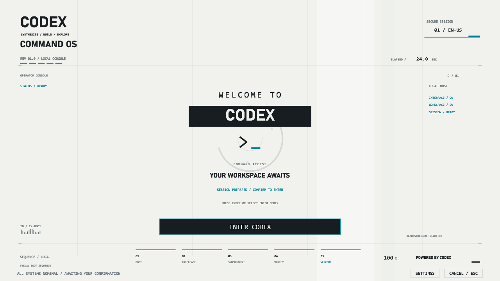

# Codex 开场动画启动器

Windows 本地启动器：播放开场动画和英文机械语音，人工确认后，在同一显示器进入 Codex。支持图片、视频、自定义音量、多屏定位和独立预览。

当前分支 `feat/bilibili-codex-boot` 为 **Codex · Command OS**：灰白底、黑色工业排版、青蓝点缀、身份资料页和连续旋转的核验圆弧。参考用户提供的 [DSH 开机动画视频](https://www.bilibili.com/pt/video/BV1dppy6yEC9/)，独立绘制 Codex 版，没有复制视频、鲸鱼标识或背景音乐。



[完整有声预览（26 秒、60 帧）](docs/previews/access-os-preview.mp4) · [工作区同步画面](docs/previews/access-os-sync.png) · [本次实现与验证](docs/Command-OS实现与验证.md)

## 构建与使用

已安装 Windows 商店版 Codex 的 Windows 电脑可使用本机 .NET Framework 编译器构建，无需 npm 或 Maven。生成语音需要英文系统语音组件；运行时读取仓库中的 WAV。

```powershell
git clone --branch feat/bilibili-codex-boot git@github.com:skacha/codex-opening-launcher.git
cd codex-opening-launcher
Copy-Item settings.example.json settings.json
.\build.ps1
.\CodexOpening.exe --preview
```

确认预览后，运行 `.\install.ps1` 创建桌面入口并准备任务栏快捷方式，按脚本提示将 `Codex.lnk` 固定到任务栏。运行 `.\CodexOpening.exe --settings` 可选择 **Codex · Command OS**、图片或视频，调节音量和时长。

本机项目在 `F:\Codex\Projects\codex-opening-launcher`，任务栏固定入口已指向这里的 `CodexOpening.exe`。本分支构建后，下次点击该固定入口即可使用新动画。正在运行的 Codex 窗口图标用于切换窗口，不会重播；应用深层链接和内部刷新也不会重播。

本地设置文件 `settings.json`、快捷方式、编译产物和测试报告均被 Git 忽略。新视觉沿用配置键 `Mode: "eva"` 和 `EvaSeconds`，已有配置可直接使用；设置界面显示新的主题名称。

## 动画与交互

五个阶段依次为启动、身份资料与接口接入、工作区同步、系统核验、欢迎与确认。默认约 24 秒，阶段由五段 WAV 的实际时长分配，同步阶段约 5 秒。进入等待页后继续显示细微环形和信号动效，等待时间另计。

画面与语音均使用英文。参考中的橙色改为青蓝色，保留浅底、留白、细分区和黑色强调条。所有界面图形均为本地 WPF 矢量，采用系统字体 Bahnschrift 和 Consolas，没有额外字体或网络依赖。身份编号与核验进度为演出内容，画面标有 `DEMONSTRATION TELEMETRY`，不会读取账号、执行安全认证或代表真实工具检查。

五句英文使用已有系统合成声线和机械处理：轻微降调、调制、短延迟叠声、动态压缩，保留此前额外提高 10% 的基础语音电平。独立合成 BGM 默认音量 38.5%，播报期间降至设定音量的 10%。没有使用参考视频中的商业歌曲。

- 五段语音完成后，启用真实的 **ENTER CODEX** 按钮；鼠标点击或 Enter 才会进入 Codex。
- 播放期间按 Esc 跳到确认页；在确认页按 Esc 取消并恢复原有 Codex 窗口。
- 打开设置时动画、语音和音乐暂停，关闭设置后继续。
- `--preview` 不提交应用启动请求。`--auto-confirm` 仅用于自动播放测试，任务栏入口不含此参数。

## 多屏接入

启动器以鼠标所在显示器为目标，使用物理坐标和 PerMonitorV2 DPI 感知，支持负坐标和不同缩放。可使用 `--screen 1` / `--screen 2` 指定 Windows 的 DISPLAY1 / DISPLAY2。

动画期间暂时隐藏现有的 Codex 主窗口；人工确认后才请求激活商店应用，再将主窗口移到动画所在屏幕后淡出。取消或异常退出时恢复窗口。只处理带 APPWINDOW 标记的无附属主窗口，排除工具窗、子窗口和附属弹窗，避免遮挡其他屏幕的鼠标输入。

本次仅替换视觉与按钮样式，沿用已经验证的 `DisplayHandoff.cs` 接入逻辑。完全退出 Codex 后的冷启动需要在下次正常退出时验收，不会为测试强制关闭当前会话。

## 预览与验证

```powershell
.\test.ps1
.\CodexOpening.exe --preview --windowed --report artifacts\manual-preview.report.json
# 完整播报后手动点击 ENTER CODEX，再检查语音和确认记录
.\verify-voice.ps1 -Report artifacts\manual-preview.report.json
# 离屏导出完整画面，含原生按钮、英文语音和 BGM
.\render-motion.ps1 -Name access-os -DurationSeconds 26 -FrameRate 60 -Audio
# 默认仍可导出六秒无声节选
.\render-motion.ps1 -Name access-os-sync -StartSeconds 9
```

离线预览复用实际界面与同一语音时间轴，导出程序不显示窗口、不启动 Codex。脚本默认使用本机 `D:\M3u8Downloader_H\ffmpeg.exe`，其他环境用 `-Ffmpeg` 指定已安装的 FFmpeg。视频导出的确认按钮是预览画面，MP4 本身不含交互。

## 主要文件

- `EvaBootScene.cs`：浅色工业终端矢量动画，保留原类名兼容接入。
- `Launcher.cs`：程序入口、媒体播放、语音、原生确认按钮和设置界面。
- `BootTimeline.cs`：根据 WAV 实际时长分配五阶段。
- `DisplayHandoff.cs`：显示器选择、主窗口筛选、隐藏与恢复、同屏衔接。
- `BgmSynth.cs`、`VoiceProcessor.cs`、`build-voice.ps1`：本地配乐与英文机械语音生成。
- `MotionPreview.cs`、`render-motion.ps1`：实际界面的离线视频及音轨导出。
- `test.ps1`、`verify-voice.ps1`、`verify-handoff.ps1`：播放、语音和启动接入验证。
- `settings.example.json`：可复制的默认配置。

## 素材与异常处理

图片支持 PNG、JPEG、BMP，限制为 20 MB、3200 万像素；视频使用 Windows 媒体组件，支持情况取决于系统解码器。图片按设定时长播放，视频播放至结束。铺满可能裁切边缘，完整显示可能留边。

素材缺失、图片解码失败或视频失败会结束开场。视频 8 秒未开始，或播放后连续 10 秒无进度，会超时退出。配置损坏时使用内置默认值，不覆盖损坏文件。音乐缺失或失败会跳过音乐。连续点击入口受单实例互斥保护。

日志位于 `%LOCALAPPDATA%\CodexOpeningLauncher\launcher.log`，不记录素材路径或内容。启动报告区分启动请求和窗口接入；提交请求不代表应用已经加载完毕。

## 历史版本与回滚

`main` 保留原 EVA 驾驶舱版本，旧预览仍在 `docs/previews/cockpit-*`。当前分支本机构建前的源码和程序备份在 `artifacts\before-access-os`。回退视觉可以切换 `main` 后重新运行 `build.ps1`；无需重建任务栏入口或改动 Codex 数据。

历史设计见 [驾驶舱视觉更新](驾驶舱视觉更新.md)、[视觉动效更新](视觉动效更新.md)。早期功能参考 [DSH 开场动画插件](https://github.com/linke-e/dsh-opening-animation)。

`migration/` 仅为此前本机 F 盘部署的专用工具，不属于默认安装步骤。Codex 本体和数据的迁移状态以 `F:\Codex\Migration\status.json` 为准，不能把项目已迁到 F 盘视为 C 盘所有占用都已迁完。详见 [迁移说明](migration/README.md)。
