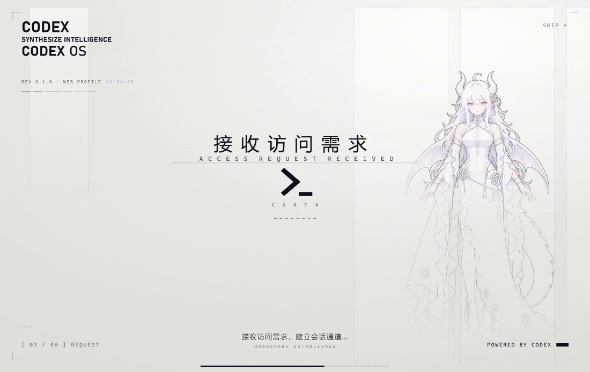

# Codex 开场动画启动器

Windows 本地启动器：先播放开场并完成授权交互，再在同一显示器进入 Codex。支持任务栏入口、英文机械语音、BGM、图片和视频。

当前分支 `feat/bilibili-codex-boot` 已按用户提供的 [参考视频](https://www.bilibili.com/pt/video/BV1dppy6yEC9/) 与截图移植原版界面，使用 [6shenhonghong9/dsh-startup-screen](https://github.com/6shenhonghong9/dsh-startup-screen) 的网页绘制器，而非此前的 WPF 风格改编。保留原版布局、字体、逐字显现、标识组装、两步授权、核验圆环和色散揭幕，将品牌与标识替换为 Codex，并按用户提供的龙娘三视图替换对应配色。



[完整有声预览](docs/previews/reference-codex-preview.mp4) · [原版移植与配色验证](docs/原版移植与龙娘配色.md) · [第三方说明](THIRD_PARTY_NOTICES.md)

## 构建与启动

需要 Windows、已安装的 Windows 商店版 Codex、.NET Framework 4.6.2 或以上与 Microsoft Edge WebView2 Runtime。本机已有所需运行时。第一次构建会从微软官方 NuGet 源下载固定版本 WebView2 SDK；下载包、依赖缓存与网页运行配置均保存在项目所在磁盘。

```powershell
git clone --branch feat/bilibili-codex-boot git@github.com:skacha/codex-opening-launcher.git
cd codex-opening-launcher
Copy-Item settings.example.json settings.json
.\build.ps1
.\CodexOpening.exe --preview --windowed
```

构建会生成 `CodexOpening.exe`、三个 WebView2 DLL、原有背景音乐和两套本地语音素材。英文语音生成需要本机英文系统声线；本机使用 Microsoft Zira，并使用机械调制、短延迟叠声和动态压缩，保留基础电平额外提高 10% 的处理。

确认预览后运行 `install.ps1` 创建桌面入口并准备任务栏快捷方式，按脚本提示将生成的 `Codex.lnk` 固定到任务栏。本机已有任务栏入口，目标为 `F:\Codex\Projects\codex-opening-launcher\CodexOpening.exe`，本次构建后即可使用新版。

应用已经运行时，点击其运行窗口图标用于切换窗口；只有指定的动画启动入口会重播开场。深层链接、内部刷新和新建会话不会重播。

## 原版播放流程

画面按最新截图恢复中英双语，语音使用英文；本次不再沿用上一版全英文大标题和新增的终端仪表。

1. 黑幕 Codex 标识、扫光与洗白。
2. 暖灰白档案底板、左上三行品牌和页脚滑入。
3. **需要访问许可 / ACCESS PERMISSION REQUIRED**：点击“授予访问权限”，或按 Enter / Space。
4. **身份资料确认 / IDENTITY VERIFICATION**：核对原版演出资料，再点击“确认身份”，或按 Enter / Space。
5. 自动播放接收访问需求、读取权限、核验通过和欢迎页。
6. 欢迎语播完并完成原版色散揭幕后，才提交 Codex 启动请求并同屏接入。

身份名称 JOYCE MOORE、编号 0087、等级 3 为上游原版演出资料，保留用于画面还原，不是账号认证或真实权限检查。正常完整播放约 25 秒，人工停留时间另计。原版的两次确认取代此前仅在结尾出现的 ENTER CODEX 确认页。

右上角 SKIP 和 Esc 跳过开场并进入 Codex；关闭窗口则取消启动并恢复原有窗口。`--preview` 不启动 Codex；`--auto-confirm` 用于回归测试自动越过两步授权。设置仍可通过 `CodexOpening.exe --settings` 或本机“开场设置”入口打开，主题名称为 **Codex · Original sequence**。

现有 `Mode=eva` 配置键保留以兼容旧设置。正常原版主题按实际语音完成情况推进，不用固定总秒数截断；小于 15 的旧短时长配置仍用于关闭完整语音并快速预览。

## 龙娘配色

从用户提供的龙娘三视图中，对深色轮廓、服装淡紫阴影和银白区域分组取样：

| 位置 | 新颜色 |
| --- | --- |
| 原强调色：时钟、阶段条、声纹、准星小点、按钮光圈 | 轮廓黑 `#120C1B` |
| 原蓝色光晕与一层色散 | 淡紫 `#C4BBDB` |
| 另一层色散、银白高光 | 银白 `#F9F5FA` |

原版底板、留白和尺寸保留。只在 `codex-palette.css` 覆盖角色配色，不改原版 CSS 的布局与动画参数。颜色值集中在 `assets/reference-boot/palette.json`，网页适配层读取这些颜色。角色三视图本身不随仓库上传，也不会作为开场背景。

## 多屏与数据位置

启动器以鼠标所在显示器为目标；支持 `--screen 1` / `--screen 2` 指定 Windows 的 DISPLAY1 / DISPLAY2，使用物理显示器坐标和 PerMonitorV2 DPI。

动画期间暂时隐藏原有 Codex 主窗口；授权与欢迎语完成后才激活应用，再将主窗口移到动画所在显示器后关闭开场。关闭或失败时恢复原窗口。沿用 `DisplayHandoff.cs` 的主窗口筛选，排除工具窗、附属窗和子窗口。

网页以截图的约 1.58:1 比例等比放置，保留边缘黑场；字体与容器统一缩放，避免多屏 DPI 改变画面比例。网页仅映射本地 `assets/`，拦截外部导航、弹窗与外部请求，不注入宿主对象。

本机源码、程序、WebView2 配置及构建缓存均位于 `F:\Codex\Projects\codex-opening-launcher`。正式运行、截图与视频录制使用独立网页配置目录，避免同时预览时的浏览器配置冲突。

## 验证与导出

```powershell
.\test.ps1
.\CodexOpening.exe --preview --windowed --report artifacts\reference-manual.report.json
# 完成两步授权、六段语音和自动揭幕后运行
.\verify-voice.ps1 -Report artifacts\reference-manual.report.json
# 正式接入报告的同屏和启动先后验证
.\verify-handoff.ps1 -Report artifacts\reference-handoff.report.json
# 录制同一个原版网页运行时，按真实播报起点混音
.\render-motion.ps1 -Name reference-codex -DurationSeconds 26 -FrameRate 60 -Audio
```

录制器不会打开 Codex。视频使用实际网页帧与实际阶段起点，而非另一个绘制器拼画面；输出可选择 30 或 60 帧编码，抓取源帧数量取决于本机合成速度，编码会补齐帧率。MP4 不含交互，预览中的前两步自动确认。默认 FFmpeg 路径为本机 `D:\M3u8Downloader_H\ffmpeg.exe`，其他环境用 `-Ffmpeg` 指定。

## 文件与兼容

- `ReferenceBootWindow.cs`：WebView2 窗口、本地资源、语音状态、同屏接入与原版帧捕获。
- `assets/reference-boot/`：上游样式、带宿主接入钩子的原版脚本、Codex 适配层与角色配色。
- `assets/reference-voice/`：与原版六阶段对应的英文机械语音。
- `Launcher.cs`：程序入口、原有图片和视频播放、配置与设置。
- `DisplayHandoff.cs`：显示器与 Codex 主窗口接入。
- `restore-webview.ps1`：官方 SDK 固定版本和 SHA-256 校验。
- `build-reference-voice.ps1`：生成原版六阶段英文语音。
- `MotionPreview.cs`、`render-motion.ps1`：实际网页运行时视频录制与混音。

图片、视频和内置通用模式沿用既有实现。图片限制 20 MB / 3200 万像素；视频使用 Windows 解码器，8 秒未开始或连续 10 秒无进度会退出。配置损坏时使用内置默认值，不覆盖损坏文件。音乐失败会静音降级。参考动画加载失败时取消启动并恢复窗口，错误类型写入日志。

本地 `settings.json`、三个 SDK DLL、可执行文件、快捷方式、网页配置和测试报告不纳入 Git。日志位于 `%LOCALAPPDATA%\CodexOpeningLauncher\launcher.log`。

## 来源与回滚

原版来源为 `6shenhonghong9/dsh-startup-screen` 的 `4a2cfe6`，原作者沈宏宏，MIT 许可随文件保留。只移植界面代码，语音和音乐使用本项目生成的素材。详见 [第三方说明](THIRD_PARTY_NOTICES.md)。

`main` 仍保留 EVA 驾驶舱版；本分支的 `aafd420` 保留此前 WPF 浅色改编。本次构建前的源码和程序备份在 `artifacts\before-reference-port`，可恢复该目录的旧程序，或在干净工作区切换对应提交后重新构建。旧版设计文档与 `access-os-*` 预览作为历史记录保留。

`migration/` 为此前 F 盘部署的专用工具，不属于默认安装步骤。Codex 本体和数据迁移状态仍以 `F:\Codex\Migration\status.json` 为准，不能把本项目位于 F 盘视为 C 盘占用全部迁完。
