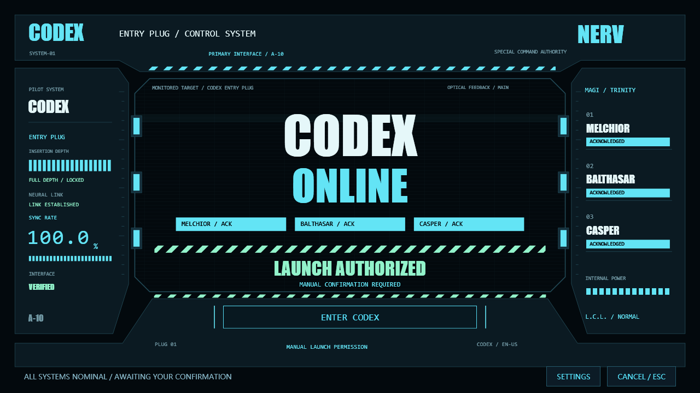

# Codex 开场动画启动器

Windows 本地启动器：先播放 EVA 插入栓驾驶舱风格的开场与英文机械语音，等待人工确认后，在同一显示器进入 Codex。支持图片、视频、自定义音量、多屏定位和独立预览。



[同步画面](docs/previews/cockpit-sync.png) · [六秒无声动效节选](docs/previews/cockpit-preview.mp4)

## 从仓库构建

本项目面向已安装 Windows 商店版 Codex 的 Windows 环境，构建使用本机 .NET Framework 编译器和英文系统语音组件。无需 Maven 或 npm。

```powershell
git clone git@github.com:skacha/codex-opening-launcher.git
cd codex-opening-launcher
Copy-Item settings.example.json settings.json
.\build.ps1
.\CodexOpening.exe --preview
```

确认预览后，运行 `.\install.ps1` 创建桌面入口并准备任务栏快捷方式；按脚本提示将生成的 `Codex.lnk` 固定到任务栏。使用 `.\CodexOpening.exe --settings` 调整配置。`settings.json` 是本机配置，不随仓库上传；编译产物、快捷方式、缓存和测试报告也不纳入版本控制。

`migration/` 是本机部署使用的专用迁移工具，不属于默认安装步骤；目录中的路径需按使用环境核对。

## 本机部署记录

项目已位于 `F:\Codex\Projects\codex-opening-launcher`，旧 D 盘路径保留兼容目录链接。Codex 本体和数据的迁移进度以 `F:\Codex\Migration\status.json` 为准。完整范围和操作见 [F 盘迁移说明](migration/README.md)。

Windows 本地实现，功能参考 [DSH 开场动画插件](https://github.com/linke-e/dsh-opening-animation)。代码独立编写，没有复制上游源码或素材。

当前机器的 Codex 来自 Windows 商店，应用标识为 `OpenAI.Codex_2p2nqsd0c76g0!App`。启动器先在鼠标所在显示器播放完整开场，结束后才提交应用激活请求，把 Codex 窗口移到同一显示器再淡出。已有 Codex 窗口会在开场期间暂时隐藏，正常关闭或异常退出路径会恢复窗口。未修改商店安装文件。

## 使用

1. 点击任务栏固定的 **Codex** 图标，或双击桌面的 **Codex 动画启动**。
2. 当前配置为 24 秒 EVA 青蓝沉浸开场，包含五段 Codex 英文机械 AI 播报。播报完成后停在确认页，点击真实的 **ENTER CODEX** 按钮或按 Enter，才会在同一显示器进入 Codex；不会自动继续。播放期间按 Esc 可跳到确认页，确认页按 Esc 则取消启动并恢复原有窗口。
3. 双击本目录的 **开场设置.lnk**，或在动画期间点击“设置”。
4. 选择本地图片或视频，调整时长、画面适配、音量和淡出时间，点击“保存设置”或“保存并预览”。预览不会启动 Codex。

图片支持 PNG、JPEG、BMP；最大 20 MB、3200 万像素。视频通过 Windows 系统媒体组件播放，支持情况取决于本机解码器；已用生成的 AVI 验证播放完成路径。MP4 通常需要系统可用的 H.264/AAC 解码器，未对所有编码组合做保证。视频播放到结束，不使用图片时长截断。默认静音。

“铺满”可能裁切边缘，“完整显示”可能出现黑边。动画只覆盖当前启动器所在显示器，不会覆盖所有显示器。

**本机任务栏入口已替换：固定的 `Codex.lnk` 指向动画启动器，原商店应用的固定项已取消。以后从该固定入口打开，会先播放动画和音乐，再进入 Codex。应用已经运行时，点击其运行窗口图标属于切换窗口，不会重播动画；深层链接、应用内部刷新和新建会话也不会重播。**

任务栏固定项的绝对路径为 `C:\Users\ssh\AppData\Roaming\Microsoft\Internet Explorer\Quick Launch\User Pinned\TaskBar\Codex.lnk`，目标为本项目的 `CodexOpening.exe`。`prepare-taskbar.ps1` 只准备入口文件和原入口备份；实际固定与取消固定由 Windows 资源管理器的菜单完成。不要把“已生成快捷方式”当成“已固定任务栏”。入口使用从本机已安装应用复制的图标 `assets/codex-app.ico`，不依赖商店包版本号路径。

## 文件

- `Launcher.cs`：入口 `Program.Main`、商店应用启动 `Program.Launch`、播放逻辑 `SplashWindow.Start/Tick/Finish`、设置窗口 `SettingsWindow`。
- `settings.json`：偏好配置；保存时先写临时文件，再原子替换，上一版保留为 `settings.json.bak`。
- `settings.example.json`：默认配置示例；实际的 `settings.json` 已加入 Git 忽略规则，个人素材路径不会被暂存。
- `CodexOpening.exe`：编译后的直接启动入口。
- `build.ps1`：使用本机 .NET Framework C# 编译器构建，无需 npm、Maven 或额外下载。
- `install.ps1`：添加桌面动画入口和设置入口，准备任务栏入口文件；同名桌面入口已指向本启动器时允许重跑，指向其他程序时拒绝覆盖。
- `prepare-taskbar.ps1`：生成 `Codex.lnk`、复制本机应用图标，保存原入口到 `artifacts/shortcut-backup/Codex 原入口.lnk`。
- `test.ps1`、`TestFixtures.cs`：生成测试素材，验证配置回退、渲染、图片播放、视频播放与失败处理。
- `artifacts/verification.json`：自动播放验证结果；`artifacts/preview.png`：默认开场静态预览。

日志位于 `%LOCALAPPDATA%\CodexOpeningLauncher\launcher.log`，只记录事件和异常类型，不记录素材路径或素材内容；超过 256 KB 后清理重建。

## EVA 青蓝终端开场

当前视觉为插入栓驾驶舱式二维控制屏：固定机械边框包住主视野，依次完成插入栓锁扣、光学准星校准、双波形同步、MAGI 三机授权和人工启动确认。主色为青蓝，粗体字、分区仪表和滚动警戒条承担视觉主体。使用合成事件驱动连续运动，语音阶段仍由实际音频时长控制。实现锚点、文件绝对路径与回滚见 [驾驶舱视觉更新](驾驶舱视觉更新.md)。上一版全息核心的历史记录见 [视觉动效更新](视觉动效更新.md)。运行 `render-motion.ps1 -StartSeconds 9 -Name cockpit` 可导出同步到 MAGI 阶段的六秒无声动效节选。

设置中的 **EVA · NERV / MAGI** 是矢量动画，不需要图片、视频或网络。分为插入栓接入、光学校准、同步、MAGI 授权、人工确认五个阶段；默认演出 24 秒，等待用户确认的时间另计。主色为青蓝 `#63E4F5`，警告色为绯红 `#FF557A`，搭配深蓝黑背景、扫描线和警示斜纹。同步率和检测文案为开场演出，不是后台真实检测数据。英文标题、提示和真实按钮共用 1600×900 等比坐标，支持多屏 DPI 缩放和非 16:9 窗口留边。

`build-voice.ps1` 使用本机已安装的英文系统声线生成五段英文 Codex 台词，素材在 `assets/voice`，不使用或克隆 EVA 原演员的声纹。语音音量独立可调，播报时 BGM 自动降至设定音量的 10%。`BootTimeline.cs` 按五段 WAV 的实际长度分配阶段，保留间隔，必要时自动延长演出；当前同步画面约 5.01 秒，语音不会被后一句打断，等待五句全部结束才启用确认按钮。小于 15 秒的短开场不播放完整语音，推荐 24 秒。构建语音需要本机英文语音组件，运行时只读取已生成的 WAV。

多屏逻辑在 `DisplayHandoff.cs`：以鼠标所在屏幕为目标，使用物理显示器坐标与 PerMonitorV2 DPI 感知；支持负坐标和多屏缩放。`--screen 1` / `--screen 2` 按 Windows 的 DISPLAY1 / DISPLAY2 名称选择。只操作带 APPWINDOW 标记的无附属主窗口，排除工具窗、无激活窗口、子窗口和附属弹窗；对旧版误放大的重叠置顶工具窗提供窄范围修复。进程信息缓存一秒，窗口移动采用异步调用，避免逐窗读取进程信息拖慢衔接。`verify-handoff.ps1` 检查实际动画屏幕、窗口目标屏幕、确认记录、启动时间先后和五段语音完成记录。屏幕 2 的鼠标点击、Enter 确认、Esc 取消和已有窗口恢复均已实际验证；未强制退出正在使用的 Codex 主程序，完全冷启动仍需下一次正常退出后验收。

视觉方向参考 DSH 社区的 [EVA / MAGI 终端风格](https://githubhelp.com/seaison/dsh-eva-ui)及 [NERV 闸门开场](https://github.com/WhatCannotBeSaid/eva-inspired-theme/tree/main/src)。这是按用户选定的特征独立绘制的同风格版本，没有将某个 DSH 插件逐帧移植，也没有复制其源码、商业字体、原作图像或音频。

实现文件为 `EvaBootScene.cs`，`OnRender()` 按归一化时间选择阶段，进度由 `Stopwatch` 经过时间计算。切换到 EVA 时保留了先前图片 / 视频路径、音量和图片时长，旧配置另存为 `settings.before-eva.json`，不加入 Git。

EVA 模式配有本项目独立合成的电子氛围背景音乐 `assets/eva-terminal.wav`，默认音量为 38.5%，比原 35% 提高 10%。设置里可以关闭音乐或调节音量；音乐随开场淡入、淡出，打开设置时暂停，关闭开场后停止。缺失音频或播放失败时跳过音乐，不影响动画和 Codex 启动。BGM 不在图片、视频和内置通用模式下播放。

## 异常处理

- 素材不存在、图片解码失败、视频解码失败：关闭开场，Codex 启动请求不会因素材错误而取消。
- 视频 8 秒未开始播放，或播放后连续 10 秒无进度：自动退出开场。
- 配置损坏：使用内置默认配置，不覆盖损坏文件。
- 连续点击桌面入口：单实例互斥，避免叠加遮罩。
- 原快捷方式始终可用。启动器的启动报告只证明已提交系统启动请求；未代表应用已加载完成，也不检查登录状态。

## 构建与验证

在 PowerShell 中进入本目录，执行：

```powershell
.\build.ps1
.\test.ps1
```

单独预览和打开设置：

```powershell
.\CodexOpening.exe --preview
.\CodexOpening.exe --settings
```

自动播放回归验证使用 `--preview --windowed --auto-confirm --config <临时配置> --report <结果文件>`，不会启动 Codex；`--auto-confirm` 仅供明确指定的非交互测试，任务栏入口不使用该参数。配置自检使用 `--self-test`；离屏静态渲染使用 `--render --progress <0到1> --output <图片路径>`。`--audit-windows --report <结果文件>` 只读检查窗口类型和中心点鼠标命中；`--repair-windows` 可隐藏旧版误放大的重叠工具窗。

## 回滚

仅关闭动画，可以在设置中取消勾选“从动画入口启动时播放开场”，任务栏图标会直接进入 Codex。也可以双击 `artifacts/shortcut-backup/Codex 原入口.lnk` 使用原入口。

恢复原任务栏入口时，先右键任务栏新增的 Codex 图标并取消固定，再在资源管理器地址栏打开 `shell:AppsFolder`，找到商店应用 ChatGPT / Codex 并选择“固定到任务栏”。这不会卸载应用或修改会话。移除项目文件夹前，应先取消固定动画入口，避免留下失效的任务栏图标。任务栏快捷方式依赖本项目的绝对路径，请勿直接移动该目录。

若需要恢复上一版偏好，先关闭设置窗口，将 `settings.json.bak` 复制为 `settings.json`。本启动器不会修改 Codex 自身的设置。

英文画面与机械 AI 语音：启动画面、按钮和设置窗口已统一为英文。语音由 Microsoft Zira Desktop 合成，经 `VoiceProcessor.cs` 处理为轻微降调、38 Hz 调制、短延迟立体声叠声、动态压缩和归一化，本次在素材层再增加 10% 增益；人声播放器默认 100%，BGM 默认 38.5%。当前最大音频采样峰值约 0.887，未削波。`assets/voice/台词.json` 记录每段时长和输入、输出电平。完整证据与本次修改路径见 [本次更新与验证](本次更新与验证.md)。
